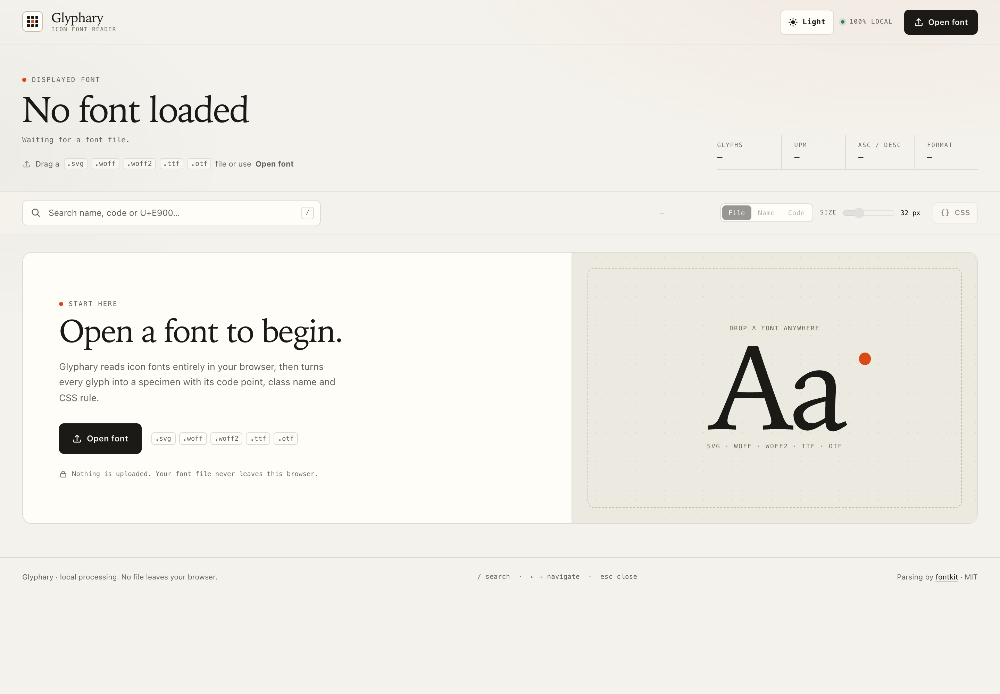
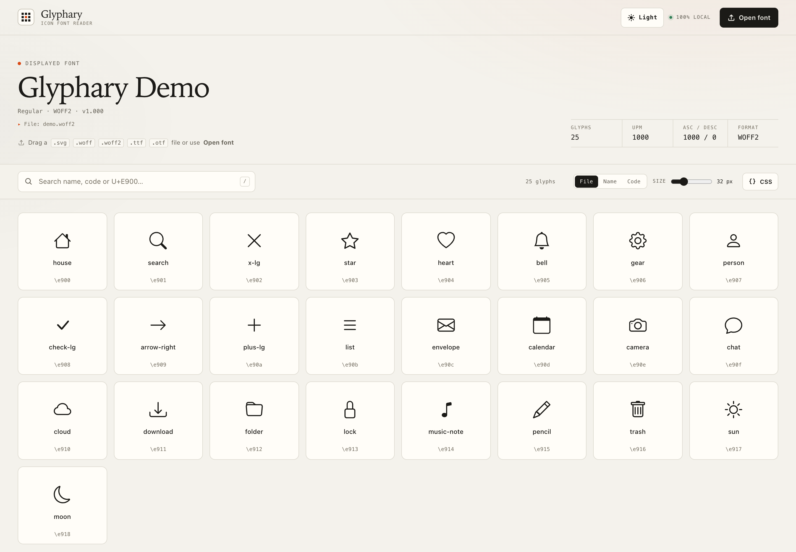

<div align="center">

# Glyphary

**Open an icon font, read every glyph, code point and CSS rule.**

Runs entirely on your machine — no uploads, no server, no font bundled in.

`SVG font` · `WOFF` · `WOFF2` · `TTF` · `OTF` · light & dark themes

</div>



## What it does

Glyphary starts empty: the first thing you do is open a font. From there it turns
every glyph into a specimen you can inspect and export.

- **Open or drop a font** — `.svg` (IcoMoon/FontForge SVG font), `.woff`, `.woff2`, `.ttf`, `.otf`. Files are read locally with `FileReader`; nothing is ever sent anywhere.
- **Real parsing** — SVG fonts are parsed from XML, binary fonts with [fontkit](https://github.com/foliojs/fontkit). Each glyph is converted to an SVG path, so you see the actual outlines, not a font preview.
- **Everything updates on load** — family name, file name, subfamily, version, format, UPM, ascent/descent, code points, `content: "\eXXX"` values and class names.
- **Search** by name, `U+E900`, `e900`, `59648`, `\e900` or the generated class name.
- **Sort** by file order, name or code point; resize the specimens with a slider.
- **Detail drawer** with a large preview, the CSS rule, Unicode/decimal/advance/glyph-id, copy character, copy CSS and a downloadable SVG of the glyph. Navigate with `←` / `→`.
- **Export** the whole sheet as CSS or CSV, with a configurable and sanitised class prefix (defaults to `icon` for every font).
- **Light and dark themes** — follows your system by default, with an Auto → Light → Dark toggle that is remembered.



## Privacy

Fonts are read with the `FileReader`/`ArrayBuffer` APIs and parsed in the page,
including the desktop webview. There is no network request, no analytics, no
service worker and no backend. The standalone HTML file works offline from
`file://`. You can verify this in the browser's Network panel: opening a font
produces no requests.

## Quick start

```bash
git clone <repo-url> glyphary
cd glyphary
npm install
npm run dev          # http://localhost:5173 with hot reload
```

Node 24 LTS is recommended (`.nvmrc` pins `24`; run `nvm use`). The supported
versions are `^22.22.2`, `^24.15.0` and `>=26.0.0` — the range required by the
test toolchain (Vitest 5, jsdom 30). Odd-numbered releases such as Node 25 are
not supported: `npm install` prints `EBADENGINE` warnings there because Vitest
and jsdom are not tested against them. Node 20 is end-of-life and cannot run the
toolchain at all.

Open the app, click **Open font** (or drop a file anywhere), and pick an icon font.

## Build the shareable file

```bash
npm run build        # -> dist/glyphary.html  (one file, ~420 KB)
```

That artifact is completely self-contained: CSS, JavaScript and fontkit are inlined.
The bundle is an IIFE on purpose, because ES modules are blocked on `file://`. You can
double click the file, keep it on a share drive, or attach it to a ticket. It contains
no font: each person opens their own.

```bash
npm start            # opens dist/glyphary.html in your browser
npm run serve        # or serve it on http://localhost:4321
node bin/glyphary.mjs --help
```

## Desktop app

The same viewer ships as a native window through [Tauri](https://tauri.app),
with no browser tab and no Node install. The window loads exactly the
`dist/glyphary.html` bundle built above, so the browser artifact and the desktop
app share one rendering path. The CSS, CSV and glyph SVG exports open the
native save dialog instead of a browser download.

The first release targets **macOS arm64**, **macOS x64** and **Windows x64**.
Linux is not bundled yet. The release workflow builds the three installers and
attaches them to the GitHub Release next to `glyphary.html`.

### Prerequisites

- Node 22.22.2+ (24 LTS recommended) and `npm install`
- [Rust](https://rustup.rs) stable
- macOS: Xcode Command Line Tools (`xcode-select --install`); the app runs on macOS 12.3 or newer
- Windows: the MSVC build tools and WebView2 (preinstalled on current Windows
  10/11; the installer downloads the runtime when it is missing)

### Run and build

```bash
npm run desktop:dev     # rebuilds the viewer, then opens the app
npm run desktop:build   # installers under src-tauri/target/release/bundle/
```

Both commands rebuild `dist/glyphary.html` and copy it to
`src-tauri/frontend/index.html` first. Restart `desktop:dev` after changing files
under `src/`.

Build another architecture by passing its Rust target:

```bash
npm run desktop:build -- --target aarch64-apple-darwin
npm run desktop:build -- --target x86_64-apple-darwin
npm run desktop:build -- --target x86_64-pc-windows-msvc
```

| Platform | Output                                                                                                   |
| -------- | -------------------------------------------------------------------------------------------------------- |
| macOS    | `src-tauri/target/<target>/release/bundle/dmg/Glyphary_<version>_<arch>.dmg`                             |
| Windows  | `.../bundle/msi/Glyphary_<version>_x64_en-US.msi` and `.../bundle/nsis/Glyphary_<version>_x64-setup.exe` |

The app icon lives in `src-tauri/icons/icon.svg`; `npm run desktop:icon`
re-renders it and regenerates the native icon set.

### Signing and first launch

The macOS bundles are **ad-hoc signed**, which keeps Gatekeeper from reporting
the app as damaged, but they are **not notarized** with an Apple Developer ID.
On first launch of a downloaded DMG, open **System Settings → Privacy &
Security** and choose **Open Anyway**. If an older build says the app is
damaged, clear the quarantine flag after copying it to Applications:

```bash
xattr -dr com.apple.quarantine /Applications/Glyphary.app
```

Windows builds are unsigned, so SmartScreen shows “Windows protected your PC”:
choose **More info → Run anyway**. A Developer ID certificate plus notarization,
and a Windows code-signing certificate, can be added later without changing the
app.

## Distribution

| Option           | Command                                             | Good for                                                                              |
| ---------------- | --------------------------------------------------- | ------------------------------------------------------------------------------------- |
| Desktop app      | `npm run desktop:build`                             | macOS `.dmg` and Windows `.msi`/`.exe`; no browser, no Node                           |
| Single HTML file | `npm run build`, then share `dist/glyphary.html`    | Zero install; Slack, Drive, a GitHub Release asset                                    |
| Tarball          | `npm pack` → `glyphary-<version>.tgz`               | Teammates run `npx ./glyphary-<version>.tgz`, or install it globally, then `glyphary` |
| Private registry | `npm publish` (see `.github/workflows/release.yml`) | Versioned installs from GitHub Packages or an internal registry                       |

```bash
npm pack                        # creates the tarball, prints its name
npx ./glyphary-<version>.tgz    # run it straight from the tarball
npm i -g ./glyphary-<version>.tgz # or install the `glyphary` command globally
glyphary --serve                # serve the viewer locally
```

## Versioning

Versions start at `0.1.0`; the first desktop release is `0.2.0`. After that,
`npm run release` bumps the patch (`0.2.1`, `0.2.2` and so on) and
`npm run release -- minor` opens a new minor line. A tag is always `v` plus that
version.

```bash
npm run release          # patch bump, commits, tags vX.Y.Z and pushes
npm run release -- minor # feature release, e.g. 0.2.0
```

That runs `scripts/release.mjs`: it refuses a dirty tree, bumps with
`npm version <patch|minor|major> --no-git-tag-version`, syncs
`src-tauri/Cargo.toml` and `Cargo.lock`, commits `Release X.Y.Z`, tags `vX.Y.Z`
and pushes with `--follow-tags`. The tag triggers
`.github/workflows/release.yml`, which checks the tag against `package.json`
with `scripts/check-version.mjs`, publishes `dist/glyphary.html`, builds the
three desktop targets and attaches the installers to the same GitHub Release.

## Using it

| Action        | How                                                                                    |
| ------------- | -------------------------------------------------------------------------------------- |
| Load a font   | **Open font** in the top bar or the welcome panel, or drop a file anywhere on the page |
| Search        | Type in the search box, or press `/` (available after a font loads)                    |
| Sort          | **File / Name / Code** segmented control                                               |
| Glyph details | Click any card; `←` / `→` move between glyphs, `esc` closes                            |
| Change theme  | Click the theme button: **Auto → Light → Dark**                                        |
| Export        | **CSS** button: edit the prefix, copy, or download CSS/CSV                             |

## Project layout

```
index.html               markup (English copy lives here and in src/lib/strings.js)
src/
  main.js                entry point
  styles/
    tokens.css           light + dark palettes (the only place colours are defined)
    app.css              layout and components, token-only colours
  lib/
    text.js              names, slugs, prefixes, number formatting
    glyph.js             CSS rules, viewBox, SVG generation
    search.js            filtering and sorting
    exports.js           CSS / CSV / single-glyph SVG output
    strings.js           every user-visible string
    parse/               svg-font.js, binary-font.js, index.js (file sniffing)
  ui/
    theme.js             auto/light/dark resolution and persistence
    app.js               state, font loading, event wiring
    grid.js drawer.js css-dialog.js dropzone.js toast.js
scripts/
  build-standalone.mjs   builds dist/glyphary.html with esbuild
  prepare-desktop.mjs    builds and copies the viewer into src-tauri/frontend
  sync-desktop-version.mjs  keeps Cargo.toml and Cargo.lock on the package version
  screenshots.mjs        writes docs/*.png for both themes
src-tauri/
  tauri.conf.json        window, bundle and version configuration
  src/main.rs            native shell and the save_export command
  capabilities/          window permissions
  icons/                 native icon set, generated from icon.svg
bin/glyphary.mjs         the CLI
tests/unit/              Vitest specs for parsing, exports, search and text
tests/e2e/               Playwright specs, run in both themes
tests/fixtures/          demo fonts generated from Bootstrap Icons (MIT), see its README
```

### Theming

`src/styles/tokens.css` defines every colour, radius and shadow for both palettes;
`src/styles/app.css` contains no literal colour. The theme is resolved before first paint by
a small inline script in `index.html` (query param `?theme=light|dark|auto` → `localStorage` →
system preference), so there is no flash of the wrong palette. Use `?theme=dark` in links and
screenshots to force a palette.

## Scripts

| Script                            | Description                                          |
| --------------------------------- | ---------------------------------------------------- |
| `npm run dev`                     | Vite dev server with hot reload                      |
| `npm run build`                   | Standalone single-file viewer (`dist/glyphary.html`) |
| `npm run build:app`               | Multi-file Vite build (`dist/app/`) for hosting      |
| `npm run preview`                 | Preview the Vite build                               |
| `npm start` / `npm run serve`     | Open or serve the standalone viewer                  |
| `npm run lint` / `npm run format` | ESLint / Prettier                                    |
| `npm test`                        | Unit + end-to-end suites                             |
| `npm run test:unit`               | Vitest                                               |
| `npm run test:e2e`                | Playwright (each spec runs in light and dark)        |
| `npm run desktop:dev`             | Rebuild the viewer and open the desktop app          |
| `npm run desktop:build`           | Build the native installers                          |
| `npm run desktop:frontend`        | Build and copy the viewer into `src-tauri/frontend`  |
| `npm run desktop:icon`            | Regenerate the native icons from `icon.svg`          |
| `npm run shots`                   | Regenerate `docs/*.png`                              |

The end-to-end suite drives the built artifact through `file://` with your installed Chrome
(`channel: 'chrome'`), so it never downloads a browser. Set `PLAYWRIGHT_CHANNEL=chromium` to
use Playwright's own build instead.

## Test fixtures

The repository ships no icon font in the app itself. The test suite uses
`tests/fixtures/demo.*`, a 25-icon font generated from
[Bootstrap Icons](https://github.com/twbs/icons) 1.11.3 (MIT) and remapped to
`U+E900–U+E918`; see `tests/fixtures/README.md` and the bundled license. Those files
are test data only and are not included in the npm package.

## Browser support

Chrome, Edge and Safari 16+ (the app uses native `<dialog>`, the popover API when present,
CSS custom properties and `backdrop-filter`).

## License

MIT. Parsing by [fontkit](https://github.com/foliojs/fontkit), also MIT. Demo fixtures
derive from Bootstrap Icons, MIT.
